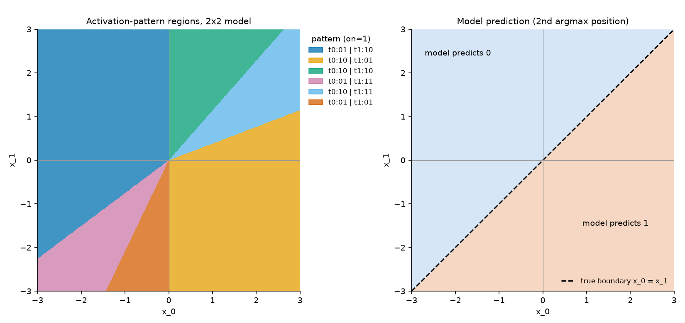

# Geometric intuitions: activation patterns and cones

This note explains the geometric picture behind several of our tools
(`run_with_cache(...).mask`, `count_patterns`, `linear_map`) and why it
matters for interpreting the 2nd argmax RNNs. It uses the smallest zoo model,
2x2 (2 neurons, sequence length 2), as a running example, because its inputs
are points in the plane and everything can be drawn.

Figures are produced by `python scripts/plot_regions_2d.py --hidden 2` (or
`--hidden 3`).

## 1. The model

Every 2nd argmax model computes, with no biases anywhere:

```
h_{-1} = 0
pre_t  = W_ih * x_t + W_hh @ h_{t-1}     (one number per neuron)
h_t    = ReLU(pre_t)
logits = W_out @ h_{last}
```

Everything is linear except ReLU.

## 2. ReLU is a switch, and the activation pattern records the switches

ReLU does one of two things to each number:

- if `pre > 0` the neuron is **on**: the value passes through unchanged;
- if `pre <= 0` the neuron is **off**: the value becomes 0.

Either way, *once you know which case applies*, ReLU is linear: multiply by 1
or by 0.

The **activation pattern** of an input `x` is the record of which case applied
for every neuron at every step: a `[seq_len, hidden]` table of 0/1 values.
In code it is `cache.mask`, which is literally `cache.pre > 0`.

### Worked example (2x2 model)

The 2x2 model's weights (rounded):

```
W_ih  = [ 4.17, -6.75 ]
W_hh  = [[-0.38,  1.29],
         [ 1.85, -0.75]]
W_out = [[ 9.54, -25.69],     (logit for position 0)
         [-9.54,  25.64]]     (logit for position 1)
```

Run the input `x = (0.5, -1.0)` through it:

| step | input | pre (neuron 0, neuron 1) | on/off |
|---|---|---|---|
| t=0 | x_0 = 0.5 | (2.09, -3.38) | (1, 0) |
| t=1 | x_1 = -1.0 | (-4.97, 10.61) | (0, 1) |

So its activation pattern is

```
         neuron 0  neuron 1
t=0          1         0
t=1          0         1
```

written compactly as `t0:10 | t1:01`. The logits are (-272.6, 272.0), so the
model predicts position 1, which is correct: 0.5 is the largest value and -1.0
at position 1 is the 2nd largest.

A *pattern* is that table of switch settings. It isn't a feature of the
input or a cluster we chose: it is just which ReLUs happened to be on.

## 3. A fixed pattern makes the whole model a single matrix

If you hold the pattern fixed, every ReLU is a fixed multiply-by-0-or-1, so
the whole network collapses to one matrix `M` (shape `[n_outputs, seq_len]`):

```
logits = M @ x      for every input x with this pattern
```

`linear_map(model, pattern)` computes `M` by tracking how each `h_t` depends
on `x`: with `D_t = diag(pattern[t])`,

```
A_{-1} = 0
A_t    = D_t (W_hh A_{t-1} + W_ih e_t^T)       so that h_t = A_t x
M      = W_out A_{last}
```

For the example pattern `t0:10 | t1:01`, `M` is about
`[[-198.1, 173.5], [197.7, -173.2]]`, and `M @ (0.5, -1.0)` gives exactly the
logits above. The tests check this exactness on many inputs.

## 4. The set of inputs sharing a pattern is a polyhedral cone

Ask: *which inputs have the pattern `t0:10 | t1:01`?* Each entry in the table
is a condition on `x`:

- "neuron 0 on at t=0" means `4.17 * x_0 > 0`;
- "neuron 1 off at t=0" means `-6.75 * x_0 <= 0`;
- the t=1 entries are conditions on `pre_1`. Given the t=0 switches, `pre_1`
  is a fixed linear function of `(x_0, x_1)`, so these are linear
  inequalities too.

So the set is defined by `seq_len * hidden` **linear inequalities**. A set
cut out by linear inequalities is a **polyhedron**: a region with flat walls.

It is also a **cone**: there are no biases, so multiplying `x` by any `c > 0`
multiplies every `pre_t` by `c` and flips no signs. If `x` is in the region,
the whole ray `{c x : c > 0}` is too. A region with flat walls that contains
every ray through its points is a **polyhedral cone**: a wedge coming out of
the origin.

You can see this directly. The inputs (1, 2) and (2, 4) lie on the same ray;
both have pattern `t0:10 | t1:10` and the same `M`, and their logits are
(64.4, -64.4) and (128.9, -128.8), the second exactly double the first.

The left panel below colours the plane by activation pattern. There are six
patterns, and every region is a wedge from the origin:



Some walls are easy to read. The vertical wall at `x_0 = 0` is the t=0
switch: neuron 0 has a positive input weight and neuron 1 a negative one, so
exactly one of them is on at t=0, depending on the sign of `x_0`. (Every
pattern starts with `t0:10` or `t0:01`.)

The cones tile the input space. **The model is exactly linear inside each
cone, and the cones are glued together continuously** (ReLU networks are
continuous, so neighbouring linear maps agree on their shared wall).

## 5. Where the decision boundary comes from

The task's true boundary for 2x2 is the diagonal `x_0 = x_1`: below it the
2nd largest is at position 1, above it at position 0. In the right panel the
model's prediction follows the diagonal almost perfectly (accuracy 99.99%).

The diagonal isn't a wall between cones; it runs *through the middle* of two
cones (light blue `t0:10 | t1:11` in the first quadrant and pink
`t0:01 | t1:11` in the third). Inside a cone, the predicted class switches
where the linear function `logit_0 - logit_1 = (M[0] - M[1]) @ x` crosses
zero:

| cone | logit_0 - logit_1 | zero line |
|---|---|---|
| `t0:10 \| t1:11` | -426.18 x_0 + 426.32 x_1 | x_1 = 0.9997 x_0 |
| `t0:01 \| t1:11` | -426.60 x_0 + 426.32 x_1 | x_1 = 1.0006 x_0 |

So the trained model has placed a cone around the diagonal and given it a
linear map whose zero line is nearly the diagonal. The tiny slope errors are
where its few mistakes come from. In every other cone the logit difference
has a fixed sign, so the prediction is constant there.

In general, explaining a model like this exactly means: for each cone, what
is `M`, and where (if anywhere) inside the cone does `M` change its argmax.

## 6. Scale invariance: only direction matters

Because the cones are rays from the origin and each `M` is linear,
`f(c x) = c f(x)` for `c > 0`: scaling an input scales the logits and never
changes the prediction. The task is the same (scaling preserves order). So
the input really lives on the **unit sphere** of directions, and:

- each cone is a patch of the sphere;
- under the training distribution (`x ~ N(0, I)`, which is rotationally
  symmetric) the probability of a cone is the **fraction of the sphere it
  covers**, its solid angle. In the 2D picture this is just the wedge's angle
  divided by 360°.

This is what makes "estimate accuracy from the mechanism" (Phase 4)
possible in principle: accuracy is a sum over cones of the fraction of each
cone where `M` gives the right answer, and these are geometric quantities.

## 7. How this scales, and what the coverage plots show

The number of possible patterns is `2^(seq_len * hidden)`: 16 for 2x2, but
2^320 for 32x10. Only a tiny fraction actually occurs, but for long sequences
even that is a lot. `count_patterns` groups random inputs by pattern, and the
**coverage plot** (`results/<model>/inspect/patterns.png`) answers: *if I
explained only the k most common cones, what fraction of inputs would I have
covered?*

| Model | Distinct patterns in 2^18 inputs | Patterns covering 90% |
|---|---|---|
| 2x2 | 6 | 5 |
| 4x3 | 67 | 13 |
| 32x10 | 257,562 | 231,348 |

For small models, a handful of cones covers almost everything, and explaining
the model cone by cone (as in section 5) is practical. For 10-step models
almost every input lands in its own cone, so we need a coarser description:

- **partial patterns**: the pattern at some steps only (`count_patterns(cache, steps=[...])`),
  e.g. just the last step, which picks out which readout matrix applies;
- **per-neuron descriptions**: "neuron 7 is on exactly when x_t is a new
  running max" summarises that neuron's switch across all cones at once;
- **always-on neurons**: a neuron that is on at every step for nearly every
  input never switches, so it behaves as a plain linear unit, which is useful
  for carrying a running value forward.

## 8. Caveats

- **Inputs exactly on a wall** (some `pre_t` exactly 0) get their own
  spurious patterns. They have probability zero under `randn`, but a grid
  that includes `x_0 = 0` hits them; `plot_regions_2d.py` uses an even grid
  size to avoid this.
- **Thin slivers.** Some cones are very narrow (see the hairline regions in
  `results/geometry/regions_3x2.png`). They hold little probability but count
  as separate patterns, which inflates pattern counts.
- **float32 rounding** can flip a switch for inputs very close to a wall. Use
  `.double()` when exactness matters.
