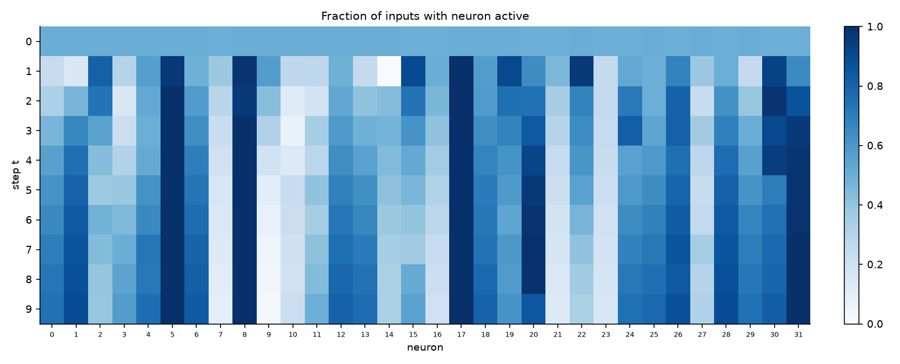

# Working hypotheses: 2nd argmax 32x10

Hypotheses about how the 32x10 model (1,376 parameters, 99.5% accuracy) works,
drawn from the activity plot (`results/2nd_argmax_32x10/inspect/activity.png`)
and the weight plot (`.../inspect/weights.png`). Each entry gives the claim,
the evidence so far, its status, and how we'll test it.

All numbers come from `python scripts/neuron_hypotheses.py --hidden 32 --seq-len 10`
on 2^17 `randn` inputs, saved to `results/2nd_argmax_32x10/hypotheses/summary.json`.
Neuron numbers refer to this model only: other models and seeds will number
their neurons differently.

**Status key.** *Correlational*: the neuron's behaviour matches the claim on
random inputs, but we haven't yet shown the model *uses* it that way.
*Causal*: confirmed by ablation or patching. *Speculative*: a guess to guide
what we look at next.

## A. Activity over time: two kinds of neuron

The activity plot shows, for each neuron and step, the fraction of inputs
where the neuron is on. Rows differ in two ways.

**Step 0 is uniform (all ≈ 0.5): explained.** At t=0 there is no previous
state, so `pre_0 = W_ih * x_0` and each neuron is on exactly when `x_0` has the
same sign as its input weight. That happens half the time for every neuron.

From step 1 on, neurons split into two groups.

### H1. Neuron 7 detects a new positive running max

**Claim.** Neuron 7 is on at step t exactly when `x_t > max(0, x_0, ..., x_{t-1})`.

**Evidence.** Its on/off state agrees with that event on 99.9-100% of inputs
at every step. Its firing rate falls like the event's probability:

| t | 0 | 1 | 2 | 3 | 5 | 9 |
|---|---|---|---|---|---|---|
| P(neuron 7 on) | 0.498 | 0.376 | 0.292 | 0.234 | 0.165 | 0.101 |
| P(event) | 0.498 | 0.376 | 0.292 | 0.233 | 0.164 | 0.100 |

The "and > 0" matters at early steps (e.g. P = 3/8 at t=1, not 1/2). Without
it, agreement drops to 87% at t=1. Comparing against `max(0, ...)` is what a
ReLU unit with no bias does naturally, and the handcrafted model uses the same
convention.

It also has the largest input weight in the model (`W_ih[7]` = 8.8; the median
|W_ih| is 0.14).

**Update (dictionary, roadmap step 1).** Its *value* is pinned down too:
`h_t[7] = max0 - max0_prev` with R² = 1.000, where `max0 = max(0, x_0..x_t)`.
That is, it outputs how much the positive running max just increased, which is
zero exactly when there is no new positive max. This is the same quantity as
handcrafted neuron 19 (`results/2nd_argmax_32x10/dictionary/dictionary.md`).

**Causal test (roadmap step 2).** Pairs of inputs differing only at step t,
where the src input's `x_t` is raised to a new positive max (`results/2nd_argmax_32x10/causal/` (`python scripts/causal_tests.py --hidden 32 --seq-len 10`)).
Because later inputs are identical, patching every neuron at step t gives
src's prediction exactly; patching subsets shows which neurons carry the
change. Flip rate = how often the patched prediction becomes src's:

| patched at step t (t = 2..8) | add a new max | remove a new max |
|---|---|---|
| everything except neuron 7 | 1-5% | 16-18% |
| neuron 7 alone | 51-57% | 29-59% |
| neurons 7 and 16 | 58-99% | 30-76% |

Without neuron 7 the rest of the hidden state almost never carries the effect
of a new max, so neuron 7 is **necessary**. It isn't sufficient alone: a new
max is also a new top-2 value, so neuron 16 fires too, and 7 + 16 together
carry 99% of the effect at t=2. Their share falls at later steps as other
neurons carry more (patching everything except 7 and 16 rises from 12% at t=2
to 45% at t=8). At the last step (t=9) the readout reads every neuron directly,
so no small subset dominates.

**Status.** Causal: necessary for the downstream effect of a new max.

### H2. Neuron 16 detects a new positive top-2 value

**Claim.** Neuron 16 is on at step t exactly when `x_t > 0` and `x_t` is one
of the two largest of `x_0..x_t`.

**Evidence.** Agreement 99.6-100% at every step; firing rate 0.203 against
event probability 0.199 at t=9. Second-largest input weight (`W_ih[16]` = 5.7).

**Causal test (roadmap step 2).** Same design, with src's `x_t` moved
above or below the running 2nd max without becoming a new max. Patching
neuron 16 alone reproduces src's prediction 83-93% of the time at t=2..7
when adding a top-2 value, and 74-89% at t=2..8 when removing one. Patching
everything except neurons 7 and 16 manages only 1-6% at t=2..7. Neuron 7 doesn't change in these pairs (no new max), so
patching it alone does nothing (0%).

**Status.** Causal: necessary and largely sufficient for the effect of a new
top-2 value.

### H3. Always-on neurons are linear memory for running values

**Claim.** Neurons that are on for (almost) every input stop switching, so
they act as plain linear units. That suits carrying a continuous value
forward through time. They store running statistics of the sequence.

**Evidence.** Neurons 5, 8, 17 and 31 are on for at least 95% of inputs at the
last step (most from step 2 or 3 on). Fitting each neuron's final value
against single candidate quantities (R² of the best straight-line fit):

| neuron | best match | R² | runner-up |
|---|---|---|---|
| 17 | max so far | 0.84 | 2nd max so far, 0.52 |
| 31 | 2nd max so far | 0.79 | max so far, 0.43 |
| 5 | max − 2nd max | 0.52 | max so far, 0.35 |
| 8 | (none fits) | ≤ 0.14 | |

**Update (dictionary, roadmap step 1).** Pooling the fit over steps 1-9
(rather than the last step only) and adding the `max0` convention sharpens
neuron 17: `h_t[17] ≈ max0_prev = max(0, x_0..x_{t-1})` with R² = 0.986, the
same quantity as handcrafted neuron 20. Neurons 5, 8 and 31 still have no
single-feature match (best R² 0.46, 0.40, 0.64), but linear fits on all
candidate features reach 0.93, 0.94 and 0.93.

**Update (step 2).** Adding the feature `2nd0_prev = max(0, 2nd largest of
x_0..x_{t-1})` identifies neuron 31: R² = 0.963. So the model keeps both a
running max (17) and a running 2nd max (31).

**Update (step 3).** Fitting each neuron separately for each lag of the max
(`results/2nd_argmax_32x10/lag_codes/coefs_lag_max.png`, from
`python scripts/lag_codes.py --hidden 32 --seq-len 10`) resolves neurons 1 and
5: at every lag they are close to a fixed multiple of the **gap** between the
max and 2nd max (neuron 1 ≈ 4.4·max − 4.1·2nd; neuron 5 ≈ 3·max − 2.7·2nd at
lags 2-9). Neuron 8 carries the max with a weight that grows with lag (≈ 0.2
at lag 2-3, ≈ 2 at lags 7-9); its role is still unclear.

**Causal test (step 3).** Pairs of inputs that differ only in the *value* of
the running max of `x_0..x_t` (same position, so every running-order event up
to t is unchanged). Patching at step t, agreement with src at t+1 of neuron
7's new-max decision, over pairs where it differs (`causal/summary.json`,
`memory`):

| patched at step t (t = 2..8) | neuron 7 at t+1 matches src | final prediction matches src |
|---|---|---|
| neuron 17 alone | 65% (53% → 72% as t grows) | 58% |
| value neurons 1, 5, 17, 31 | 80% | 77% |
| everything except 1, 5, 17, 31 | 20% | 21% |

**Status.** Causal: neuron 17 is the main carrier of the running max's value,
and with the gap (1, 5) and 2nd-max (31) neurons it carries 80% of it. The
rest is spread over neurons that hold the max at particular lags (H4).

### H4. Position is encoded by lag: a reset-started clock and lag-tagged copies of the max

**Original claim (speculative).** Something must remember *when* the max and
2nd max arrived; the time-varying neurons might encode time since events.

**Result (roadmap step 3).** Confirmed and made specific.
(`python scripts/state_analysis.py --hidden 32 --seq-len 10` → `results/2nd_argmax_32x10/state/`;
`python scripts/lag_codes.py --hidden 32 --seq-len 10` → `results/2nd_argmax_32x10/lag_codes/`.)

1. **The hidden state is mostly the minimal algorithm state.** An exact online
   algorithm needs only the max and 2nd max so far and their lags (steps since
   each arrived). Grouping inputs by (step, lag of max, lag of 2nd max) and
   fitting linearly in the two values and the current input within each group
   explains each neuron's value with median R² = 0.94 (21 of 32 neurons ≥ 0.9;
   positions alone give 0.59). The 16x10 model scores higher (0.97, 15 of 16
   ≥ 0.9). The handcrafted model scores lower on this test (13 of 22 ≥ 0.9)
   because its shift register stores every past input, not just the top two.
2. **A clock restarted by every new max.** Neuron 7's resets (H5) put its
   targets in a fixed state one step after a new max. From then on, many
   neurons switch on and off according to the lag alone: P(on | lag of max = k)
   varies by a median of only 0.02 across steps t for lags ≥ 2. Examples, with
   P(on) at each lag k = 0..9:
   - neuron 27: on only at lags 3 and 7 (1.00), otherwise ≤ 0.04 apart from
     lags 0, 6, 9 (0.39, 0.37, 0.51);
   - neuron 11: on at lags 3, 5, 9 (1.00, 1.00, 0.97) and 7 (0.86), off at 1, 2, 4, 6;
   - neuron 10: on at lags 4-5 (0.66, 0.78), off at 1-3 and 6-8;
   - neuron 24: off only at lag 4 (0.01); neuron 30: off only at lag 5 (0.04);
   - neurons 25, 28: off only at lag 1 (0.10), the reset state;
   - neuron 3: ramps up with lag (0.07 at lag 2, 0.49, 0.72, then 0.81-0.88).
3. **Lag-tagged copies of the max.** Some neurons carry the max value only
   when it arrived a specific number of steps ago (coefficient on the max at
   that lag, final step): neuron 22 at lag 2 (2.0), 19 at lag 3 (1.6), 2 at
   lag 6 (2.6), 26 at lag 7 (4.0), 15 at lag 8 (3.6). This is why the
   dictionary matched them, partially, to delayed copies of the input
   (`relu(x_{t-k})`, R² 0.63-0.80). They work like the handcrafted shift
   register, but only for the top two. **Update (§G, H11):** they are also on
   when the input at their lag is the running 2nd, so they mark top-two
   membership, not just the max.
4. **"Reference minus current" neurons with a lag-dependent reference.**
   Neurons 0, 6, 13, 18, 29 are ≈ `b·max + c·2nd − 1.7·x_t` with `b + c`
   roughly constant and the split between max and 2nd switching with the lag
   (e.g. neuron 13: mostly max at lags 2, 5, 7, 8; mostly 2nd at 3, 4, 6, 9).
   Because the model is scale-free, a difference between two such neurons
   is proportional to `max − 2nd`, with a sign set by the lag.
5. **At the final step these become position flags.** Lag k at the last step
   is position 9 − k, so clock neurons read as "position p is (not) in the
   top two" (`state/summary.json`, `p_on_final_given_pos_in_top2`): neuron 25
   is off when position 8 holds the max or 2nd max (P(on) 0.009 vs 0.973
   otherwise), 24 when position 5 does (0.002 vs 0.940), 20 when position 0
   does (0.265 vs 0.996); 22 is on when position 7 does (1.000 vs 0.163).

**Status.** Lag code: correlational but very clean (exact 0/1 on-rates,
step-invariant). Clock driven by the resets: causal for the reset itself
(H5); the downstream clock dynamics are not yet causally tested.

**Open.** The lag of the 2nd max is encoded less cleanly: P(on | lag of 2nd)
varies more across steps (median spread 0.06 for lags ≥ 2, 90th percentile
0.28). How the readout combines these codes into logits 0-8 is the next
question.

## B. Large weights implement discrete logic

Typical weights are small: median |W_hh| is 0.095 and median |W_out| is 1.1.
A few are far larger (up to about 320x the median in W_hh and 60x in W_out),
and almost all of them involve neurons 7 and 16.

### H5. Neurons 7 and 16 send "reset" signals

**Claim.** When a new max arrives, neuron 7 forces a set of neurons to zero,
clearing state that the new max makes stale. Neuron 16 does the same for a
smaller set when a new top-2 value arrives.

**Evidence.**
- **46.5%** of all recurrent weight magnitude (sum of |W_hh|) leaves neuron 7,
  and **10.4%** leaves neuron 16. The next-largest neuron accounts for 2.6%.
- The largest recurrent weights are all negative and come from these two:
  7→29 (−30.7), 7→13 (−30.5), 7→0 (−24.7), 16→3 (−13.7), 7→28 (−13.7),
  7→3 (−11.6), 7→11 (−10.5), 16→25 (−9.9), ...
- When neuron 7 fires, its value is typically about 5 (median when on), so it
  pushes its targets' pre-activations down by roughly 50-150. That's far more
  than anything else feeds them, so they are forced off.

**Prediction.** Neurons 29, 13 and 0 are (almost) exactly zero at step t+1
whenever neuron 7 is on at step t.

**Test (roadmap step 2).** Targets are neurons with `W_hh[target, source] < -5`
(`results/2nd_argmax_32x10/causal/` (`python scripts/causal_tests.py --hidden 32 --seq-len 10`), `resets.png`):

- **The prediction holds for every target.** P(target = 0 at t+1 | source on
  at t) is 0.98-1.00 for all 10 targets of neuron 7 and both targets of neuron
  16, against 0.004-0.76 when the source is off.
- **Cutting the edges shows which resets the edges cause.** With 7's
  reset edges removed, targets 0, 13, 28 and 29 fall back to their "source
  off" rates (P(0 | on) = 0.30, 0.15, 0.01, 0.23): those resets are caused by
  neuron 7. Targets 3, 10 and 25 stay zeroed (0.998-1.000): something else
  also zeroes them. For 3 and 25 that's partly neuron 16, which fires at
  every new max too. Targets 11, 23 and 27 are in between.
- **The resets matter.** Cutting 7's reset edges drops accuracy from 99.5% to
  67.4%; cutting 16's two drops it to 72.3%.

**Status.** Causal.

### H6. Neuron 7 vetoes position 9 in the readout

**Claim.** The largest weight in the model, `W_out` from neuron 7 to logit 9
(**−65.1**), is a veto: if the last input is a new max, position 9 is the
largest value, so it cannot be the 2nd largest.

**Evidence.** The logic fits H1 exactly, and this is a rule that is always
right, so cross-entropy training would keep strengthening it. Neuron 12 →
logit 9 (**−39.7**) is a second large negative weight on the same logit. Its
role is unknown; it may be a related veto (neuron 12's input weight is −3.1,
so it reacts to *small* final inputs).

**Prediction.** Removing just this one weight's contribution (leaving neuron 7
in place elsewhere) causes errors mainly on inputs whose max is at position 9,
predicting 9 instead of the true 2nd argmax.

**Test (roadmap step 2).** `results/2nd_argmax_32x10/causal/` (`python scripts/causal_tests.py --hidden 32 --seq-len 10`), `veto.png`. Removing the 7 → logit 9
weight drops accuracy from 99.5% to 96.8%, and accuracy on inputs whose max is
at position 9 from 99.2% to 72.4%. 86% of the new errors have the max at
position 9, and 88% predict position 9. Accuracy at every other max position
is unchanged.

**Status.** Causal. Prediction confirmed.

### H6b. Neuron 12 vetoes position 9 when x_9 is too small

**Claim.** Neuron 12 computes `relu(max(0, 2nd largest of x_0..x_{t-1}) - x_t)`,
how far the current input falls below the running 2nd max, and its readout
weight to logit 9 (**−39.7**) rules out position 9 when `x_9` is too small to
be the 2nd largest. Together with H6, logit 9 is vetoed exactly when `x_9` is
above the max (neuron 7) or below the 2nd max (neuron 12).

**Evidence.** Dictionary fit R² = 0.998 (feature `relu(2nd0_prev-x_t)`,
`results/2nd_argmax_32x10/dictionary/dictionary.md`). Removing the 12 → logit 9
weight drops accuracy to 94.8%. 94% of the new errors wrongly predict position
9, but almost none have the max at 9 (1%). Among wrong predictions of 9, `x_9`
is usually just below the true 2nd max: it is the 3rd largest in 2,250 of
3,219 cases, then 4th (717), 5th (192).

**Status.** Value: correlational (very strong). Veto: causal.

### H7. Why the important weights are the large ones

Not a claim about one neuron but a reason to expect this pattern:

1. **Large gains turn ReLUs into switches.** A big weight makes a neuron jump
   from 0 to large over a tiny input change, which approximates if/then logic
   such as "is x_t bigger than the stored max?" The task is logical, so the
   model needs switches.
2. **Cross-entropy rewards confident margins,** so weights behind
   always-correct rules (vetoes, resets) keep growing.
3. **Weight decay (0.001) shrinks weights that don't earn their size,** so a
   large weight that survives training is probably doing real work. This fits
   the ablations: removing neuron 7 or 16 costs 75-90% accuracy.

## C. Overall sketch

Putting H1-H6 together, the model may be running an online algorithm much like
the handcrafted 10-step model:

1. **Detect events** each step: new max (neuron 7), new top-2 (neuron 16).
2. **Hold running values**: max so far (17), 2nd max so far (31), their gap
   (1, 5).
3. **Reset stale state** when an event fires (large negative W_hh from 7 and 16).
4. **Track when** things happened: a clock restarted by each reset (10, 11,
   24, 25, 27, 28, 30, ...) and lag-tagged copies of the max (2, 15, 19, 22,
   26) (H4).
5. **Read out** the position, with hard vetoes for impossible answers: for
   the last position, "too big" (neuron 7, H6) and "too small" (neuron 12, H6b).

Steps 1, 2 (neuron 17), 3 and 5 have causal support (roadmap steps 2-3); step 4 is a clean correlational result.

The hand-built model (`handcrafted_2nd_argmax(10)`) uses a different but
related scheme: a shift register of past inputs, plus running max and
"max minus current" neurons. Roadmap step 1 found the overlap is concrete:
32x10 neurons 7 and 17 compute exactly the handcrafted running-max register
(handcrafted neurons 19 and 20), and a linear fit on all 22 handcrafted
neurons explains a median R² of 0.83 of each 32x10 neuron's value (0.95 for
the 16x10 blog model). See the step 1 results in [PLAN.md](PLAN.md#roadmap). Comparing the two is part of roadmap step 4 in [PLAN.md](PLAN.md#roadmap).

## D. Neuron roles in 32x10

Summary after roadmap steps 1-3. *Drop* is the accuracy lost under mean
ablation at all steps (`dictionary/dictionary.md`); *state R²* is the share of
the neuron's value explained by the ideal state plus current input
(`state/summary.json`).

| neuron | role | evidence | drop | state R² |
|---|---|---|---|---|
| 7 | new positive max: `max0 − max0_prev` (H1) | causal | 0.88 | 1.00 |
| 16 | new positive top-2 value (H2) | causal | 0.75 | 0.93 |
| 17 | running max (H3) | causal | 0.58 | 1.00 |
| 31 | running 2nd max | correlational (R² 0.96) | 0.33 | 0.96 |
| 1, 5 | gap between max and 2nd max | correlational (per-lag fits) | 0.25, 0.31 | 0.96, 0.96 |
| 12 | how far x_t is below the running 2nd max; vetoes position 9 (H6b) | causal (veto) | 0.44 | 1.00 |
| 0, 13, 29 | reference − current input, reference switches max/2nd by lag; reset by 7 | causal (reset), correlational (role) | 0.37, 0.45, 0.46 | 0.99 |
| 6, 18 | reference − current input, as above, not reset by 7 | correlational | 0.27, 0.20 | 0.99 |
| 10, 11, 27 | clock: on at specific lags of the max | correlational | 0.003, 0.14, 0.07 | 0.90-0.98 |
| 24, 30 | clock: off at one lag (4, 5) | correlational | 0.08, 0.33 | 0.79 |
| 25, 28 | clock: off only right after a reset | causal (reset) | 0.19, 0.11 | 0.89, 0.94 |
| 3 | clock: ramps up with lag; reset by 7 and 16 | causal (reset), correlational | 0.16 | 0.94 |
| 2, 15, 19, 22, 26 | delay line: on when the input at lag 6, 8, 3, 2, 7 is in the top two (H11) | causal as a group (§G) | 0.06-0.33 | 0.86-0.96 |
| 21, 23 | on when x_t is a new max (final-step readout) | correlational | 0.18, 0.23 | 0.98, 0.89 |
| 20 | off when position 0 is in the top two (at the final step) | correlational | 0.08 | 0.86 |
| 8 | always on; carries the max more at larger lags | unclear | 0.08 | 0.88 |
| 4, 9, 14 | unexplained; ablation costs ≤ 2% | — | ≤ 0.02 | 0.66-0.83 |

## E. Generality: other seeds and model sizes (roadmap step 4)

Sources: `results/compare/compare.md` (`python scripts/compare_models.py`,
13 models) and `results/compare/causal.md` (`python scripts/causal_tests.py`
on each 32x10 seed with its own neuron numbers, then
`python scripts/summarize_causal.py`). Neuron numbers differ between models,
so roles were matched by behaviour, not index.

**Universal across all five 32x10 seeds** (and the zoo's 16x10):

- **An exact new-max detector** (H1). Every seed has one neuron whose value
  is `max0 − max0_prev` (R² 1.00) and whose on/off agrees with "new positive
  max" on ≥ 99.6% of inputs. So does the zoo 16x10 model (99.8%).
- **The detector vetoes the last position** (H6). In every seed and in the
  zoo 16x10, the largest readout weight is detector → last logit (−22 to
  −71). Removing it drops accuracy on inputs whose max is last from 0.99 to
  0.67-0.72 (seed 2: 0.03). Causal in all five seeds.
- **A "below the 2nd max" neuron that vetoes the last position** (H6b).
  Every seed has a neuron matching `relu(2nd0_prev − x_t)` with R² ≥ 0.95.
  Removing its weight to the last logit causes wrong "last position" answers
  (72-100% of new errors) in every seed, and costs from 1% (seed 3) to 76%
  (seed 1) accuracy.
- **Resets from the detector** (H5). The detector has the largest outgoing
  recurrent weight share in every seed (14-47%), and its strong targets are
  zero after it fires (P ≥ 0.98). How much accuracy depends on them varies:
  cutting them costs 0% (seed 2) to 35% (seed 4).
- **A lag clock** (H4). Every seed has 4-8 neurons that are always on at some
  lag ≥ 2 of the max and always off at another.
- **Minimal-state encoding** (H4). Median state R² 0.92-0.95 in every seed.

**Seed-specific:**

- **How exclusively the detector carries a new max.** Patching everything
  *except* the detector transfers the effect of a new max 3% of the time in
  seed 0 (so the detector is necessary there) but 16-67% in seeds 1-4, where
  other neurons also carry it.
- **The top-2 detector** (H2): ≥ 99% event agreement in seeds 0-3, 90% in
  seed 4; patched alone it transfers 86% (seed 0) down to 0% (seed 4).
- **A single running-2nd-max neuron** exists only in seed 0 (R² 0.96; other
  seeds 0.46-0.71). A single running-max neuron exists in all (0.92-1.00),
  but how much of the max's value it carries alone varies (38-78%).

**Other sizes:**

- **16x10 has two solution types.** The zoo's best 16x10 seed looks like
  32x10 (detector, veto −37.6, 64% reset share, a clock neuron). The blog's
  16x10 model looks like the handcrafted model: no detector veto, no clock,
  low reset share (0.17), and a near-exact `max0 − x_t` neuron (R² 0.99, as
  handcrafted neuron 21).
- **The failing 8x10 model (43%) lacks the mechanism**: no event detector
  (best agreement 0.39), no veto, and state R² only 0.76.
- **8x6 (79%) and 8x5 (88%)** have the detector (≥ 97%) but no clock (0-1
  clock neurons); there aren't enough neurons for both.
- **8x4 and 4x3 (≥ 98.5%)** reach high accuracy with only a weak detector
  (≤ 85%): short sequences don't need this machinery.

## F. Errors and the quantitative checks (roadmap step 6)

Full write-up: [results/2nd_argmax_32x10/README.md](../results/2nd_argmax_32x10/README.md);
numbers from `python scripts/explain_32x10.py --hidden 32 --seq-len 10`.

- **The minimal-state explanation covers all correct behaviour.** A
  surrogate final state built from the positions of the max and 2nd max
  agrees with the model on 99.44% of fresh inputs: exactly those the model
  gets right.
- **H8 (new). Errors come from two mechanisms.**
  - **The max(0, …) blind spot.** When the 2nd largest input is negative
    (1.08% of inputs), the error rate is 21.6%, causing 42% of all errors.
    Comparing against running values clipped at 0 can't rank negative values.
  - **Finite comparison resolution.** When the 2nd and 3rd largest are within
    3% of each other (5.8% of inputs), the error rate is 3.7%, causing 38% of
    errors. 66% of all errors predict the 3rd largest.

  *Status: correlational, strong.* The new-top-2 detector has a biased
  threshold: it fires up to about 1% below the running 2nd max. But it alone
  doesn't produce the errors: predicting them from its bias gives 8,858
  against 833 measured. Near-ties are resolved jointly by several neurons.

## G. How the readout decodes positions 0-8

Numbers from `python scripts/readout_analysis.py --hidden 32 --seq-len 10`
(`results/2nd_argmax_32x10/readout/`), on 2^19 fresh float64 inputs. Groups
are the roles in §D, with "clock" = 3, 10, 11, 27, 28 and "membership flags" =
20, 24, 25, 30.

### H9. The final state is an additive position code, read by a matched filter

**Claim.** Averaged over inputs, the final hidden state (normalised to unit
length, which doesn't change the prediction) is a sum of two codes, a(i) for
the max's position and b(j) for the 2nd max's position. The readout acts as a
matched filter on b: W·b(j) is highest for logit j.

**Evidence.**
- The per-cell mean states fit a(i) + b(j) with R² = 0.962.
- A surrogate final state a(i) + b(j) is 100% accurate and agrees with the
  model on 99.44% of inputs: every input the model gets right.
- **B = W·b is diagonal** (`readout/codes.png`). For positions 0-8, logit j
  beats every other logit by 0.9-1.4 (unit-normalised scale) when the 2nd max
  is at j. Logit 9 is suppressed by about 9.5 unless the 2nd max is at 9.
- **A = W·a is weakly diagonal for positions 0-8** (+0.3 to +0.8): being the
  max slightly *favours* a position, which the 2nd-max code's larger margin
  overrides. Position 9 is the exception: a vetoes it (−8.3) when the max is
  there, which is neuron 7's veto (H6).

**Status.** Correlational (fits), plus the surrogate test.

### H10. The model's errors are value-dependent noise overwhelming the position margin

**Claim.** Per input, the state also has a large value-dependent part (a(i) +
b(j) explains only 55% of each normalised final state). The readout largely
ignores it, and the model errs when it doesn't.

**Evidence.**
- The value-dependent part flips some readout comparison on 0.56% of inputs,
  exactly the model's error rate. Typically it moves the decisive margin by
  26% (99th percentile: 207%).
- The readout can only see 9 of the 32 dimensions (those that change logit
  differences). A random direction would have 28% of its variance there; the
  value-dependent part has only 12.6%.

**Status.** Correlational, strong. It links to H8: near-ties and negative
values make the margin small relative to this noise.

### H11. The 2nd max's position is carried by a top-2 delay line and per-lag membership flags

**Claim.** For each lag k, a neuron flags "the input k steps ago is among the
running top two". This holds whether that input is the max or the 2nd, so
it survives when a new max demotes the old one. Value-comparison neurons then
separate the max from the 2nd.

**Evidence.**
- **Delay-line neurons** (22, 19, 2, 26, 15 for lags 2, 3, 6, 7, 8) are on
  99.1-100% of the time when the input at their lag is the running max *or*
  the running 2nd, against 24-82% otherwise (and at lower amplitude),
  pooled over all steps.
- **Membership flags** for other lags are off when the input at that lag is
  in the top two: neuron 25 (lag 1, 87% accurate as a classifier), 24 (lag 4,
  91%), 30 (lag 5, 93%), 20 (lag 9, 94%), against majority baselines of
  57-80%. Lags 7 and 8 have no better-than-baseline on/off flag; there the
  delay neurons' amplitude carries membership.
- **Final-step ablations** (`final_step_ablation`): mean-ablating the
  membership flags at the last step only cuts accuracy to 73% (after) / 72%
  (before); the delay line to 90% / 72%; the reference neurons to 44% / 59%.
- **Patching** between inputs with the same max position but a different 2nd
  position, copying a group's final state from the other input, moves the
  prediction to the other input's answer: delay line 14% (23% in the
  "before" case), membership flags 9%; delay + flags 46% (63% before);
  + reference 67%; + neuron 12 **80%** (15 neurons). No other group moves it
  more than 2%.

**Where the 15 neurons fall short** (`patch_2nd_position.base_15_by_position`).
They transfer the 2nd max's position least well when it moves to position 8
(54%) or 7 (59%), i.e. lags 1-2, and when the max is at position 9 (58%).
Greedily adding neurons (`greedy_from_base_15`): + 3 → 85%, + 4 → 89%, + 14 →
92%, + 8 → 93%, + 5 → 94%, + 21 → 94%, + 16 → 96%, + **23 → 99.6%** (23
neurons). Neuron 14 is a second lag-1 flag (on when position 8 is in the top
two; see `state/summary.json`), and 21 and 23 cover the cases where the last
input is involved.

**Status.** Causal: 23 neurons carry 99.6% of the 2nd max's position at the
readout; 15 of them (delay line, flags, reference, 12) carry 80%.

### H12. Which top-two input is the max is a separate code, carried by the reference neurons and the clock

**Claim.** The membership code (H11) is the same whether an input is the max
or the 2nd. A separate code says which of the two is the max, carried by the
reference neurons and the clock.

**Evidence** (`swap_max_and_2nd`). Swapping the max's and 2nd max's values
keeps the set of top-two positions and only flips which one is the max. The
correct answer moves from the 2nd's position to the old max's. Patching a
group's final state from the swapped input moves the prediction there:

| group patched | prediction moves |
|---|---|
| reference (0, 6, 13, 18, 29) | 62% |
| clock (3, 10, 11, 27, 28) | 35% |
| new-max detector (7) | 9% |
| last-max (21, 23) | 3% |
| **delay line, membership flags** | **0%** |
| everything else | ≤ 0.5% |

The two codes are cleanly separated: the membership neurons carry no
max/2nd information. Greedy patching reaches 94% with 10 neurons: 13, 6, 3, 7,
0, 29, 11, 28, 21, 23.

**Sufficiency** (`role_sets.sufficiency`, final step, unit-normalised). Keeping
only the membership neurons (delay line, flags, 14), the identity neurons
(reference, clock, 7) and the last-position neurons (12, 16, 21, 23), with the
other 7 neurons (1, 4, 5, 8, 9, 17, 31) mean-ablated, agrees with the model
on 95.0% of inputs. Membership + identity alone: 75%; either alone: 22-28%.

**What the other 7 do.** They aren't position carriers. Resampling them from
other inputs with the same max and 2nd positions changes 3.8% of predictions,
about as many as resampling the *kept* 25 the same way (4.2%), and the changed
inputs have smaller margins (median 0.38 vs 0.56 overall). So the remaining
gap is value-dependent sensitivity on low-margin inputs. A hypothesis that the
value neurons cancel the reference neurons' value-dependent part is refuted:
their within-cell contributions to the margin are uncorrelated (−0.02).

**Status.** Causal at group level.

**Open.** How each reference neuron's lag-dependent mix of max and 2nd
(`lag_codes/coefs_lag_max.png`) combines with the clock to mark the max at
each lag, written out neuron by neuron.

## Testing

The order in which these hypotheses get tested, alongside the rest of the
project, lives in the roadmap in [PLAN.md](PLAN.md#roadmap). Update each
hypothesis's **Status** here as results come in.
