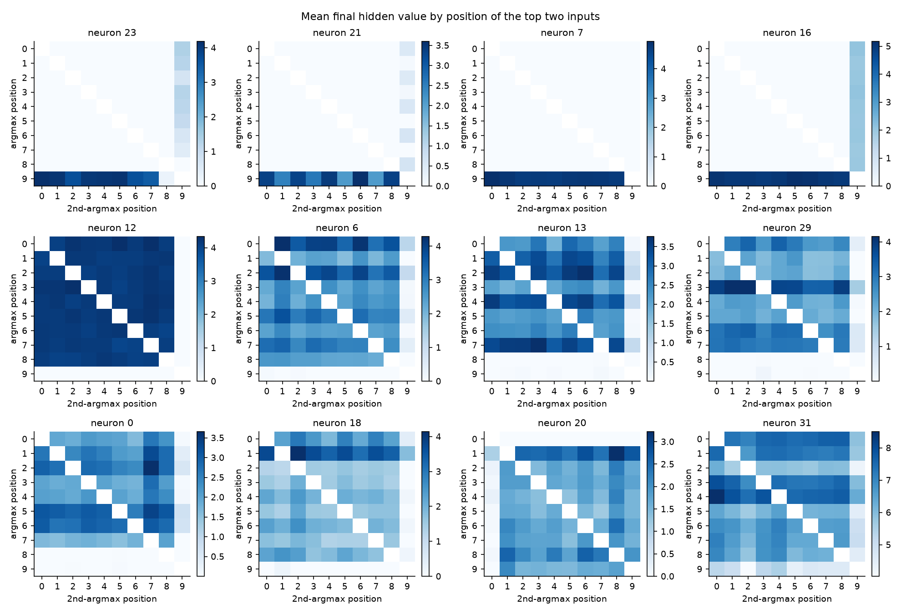
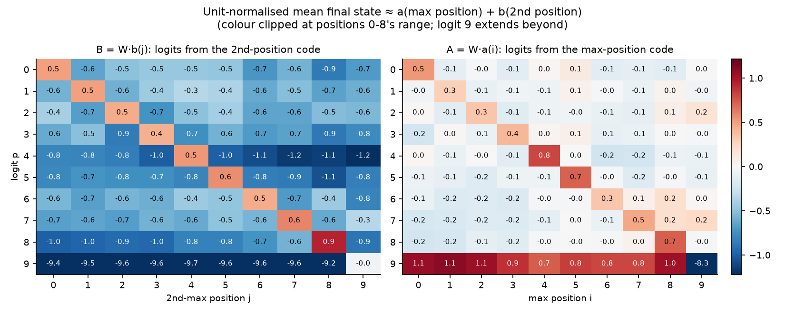
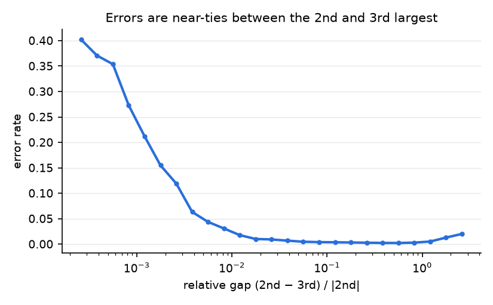

# 2nd argmax 32x10: how it works

The zoo's 2nd argmax RNN with 32 hidden neurons and 10 inputs (1,376
parameters, 99.44% accurate). It reads `x_0..x_9` one at a time and outputs a
logit for each position, and has to point at the 2nd largest input.

This write-up collects roadmap steps 1-6. Evidence for each claim is in
[docs/HYPOTHESES.md](../../docs/HYPOTHESES.md), and every number comes from a
script (listed under [Reproducing](#reproducing)). Neuron numbers refer to
this model (seed 0); other seeds use different numbers for the same roles.

## Summary

The network runs an online algorithm close to the minimal one: after each
input it effectively knows the largest and 2nd-largest values so far and how
many steps ago each arrived.

1. **Detect events.** One neuron fires exactly when the input is a new
   positive running max, and outputs how much the max just increased (neuron
   7, R² 1.00). Another fires when the input is a new positive top-2 value
   (neuron 16, 99.6-100% agreement).
2. **Store values.** Neurons hold the running max (17), the running 2nd max
   (31), and the gap between them (1, 5).
3. **Reset.** When a new max arrives, the detector's large negative recurrent
   weights (up to −31) zero about ten neurons on the next step.
4. **Keep time.** From that reset, a set of neurons runs a fixed on/off
   sequence that depends only on how long ago the max arrived (a clock). Other
   neurons each watch one lag and mark whether the input that many steps back
   is among the top two (a delay line). Together these encode *where* the max
   and 2nd max are.
5. **Read out.** The final state is (on average) a sum of a code for the
   max's position and a code for the 2nd max's position, and the readout is
   a matched filter on the second. Two separate codes feed it: a delay line
   marks which recent inputs are in the top two (surviving the reset), and
   the reference neurons and clock say which of those two is the max.
   The last position gets two hard vetoes: "x_9 is the new max" (neuron 7,
   weight −65) and "x_9 is below the running 2nd max" (neuron 12, weight −40).
6. **Compare against max(0, …).** All comparisons are against running values
   clipped at 0, which a ReLU without biases gets for free. This is also the
   model's main blind spot.

## Mechanism

### 1. Events (H1, H2)

| neuron | computes | match | causal test |
|---|---|---|---|
| 7 | `max(0, x_0..x_t) − max(0, x_0..x_{t-1})`: on exactly at a new positive max | R² 1.000; on/off agreement 99.9-100% at every step | Patching every neuron *except* 7 transfers a new max's effect only 1-5% of the time: 7 is necessary |
| 16 | on when x_t > 0 and is among the two largest so far | agreement 99.6-100% | Patching 16 alone transfers a new top-2 value's effect 74-93% of the time |

### 2. Stored values (H3)

| neuron | computes | match |
|---|---|---|
| 17 | `max(0, x_0..x_{t-1})` (running max, same as handcrafted neuron 20) | R² 0.986 |
| 31 | `max(0, 2nd largest of x_0..x_{t-1})` | R² 0.963 |
| 1, 5 | a fixed multiple of max − 2nd max, at every lag | per-lag fits (`lag_codes/coefs_lag_max.png`) |
| 12 | `relu(max(0, running 2nd) − x_t)`: how far the input falls below the 2nd max | R² 0.998 |

Changing only the running max's *value* and patching neuron 17 alone carries
65% of the change into the next new-max decision; 17 with 1, 5 and 31
carries 80%.

### 3. Resets (H5)

46.5% of all recurrent weight magnitude leaves neuron 7. After 7 fires, each
of its ten strong targets is zero on the next step 98-100% of the time.
Cutting those edges shows 7 directly causes the resets of neurons 0, 13, 28
and 29. Without its reset edges, accuracy falls from 99.5% to 67.4%.

### 4. Position: a clock and a delay line for the max (H4)

The minimal online algorithm needs the max, the 2nd max and their lags.
Grouping inputs by (step, lag of max, lag of 2nd max) and fitting linearly in
the two values and the current input explains a median **R² of 0.94** of each
neuron's value (21 of 32 neurons ≥ 0.9). Positions alone give 0.59.

- **Clock.** From two steps after a new max, many neurons' on/off state depends
  only on the lag. It varies by a median of just 0.02 across steps. For
  example, neuron 27 is on exactly at lags 3 and 7, neuron 11 at lags 3, 5 and
  9, neuron 24 is off only at lag 4, and neurons 25 and 28 are off only right
  after a reset. It is causal: swapping which top-two input is the max and
  patching only the clock at step 4 moves the final prediction 34% of the time
  (`clock/summary.json`). Patching the clock together with the reference
  neurons and neuron 7 moves it 85-92%.
- **Delay line for the top two.** Neurons 22, 19, 2, 26 and 15 carry the max
  value when it arrived 2, 3, 6, 7 or 8 steps ago. They also stay on when
  the input at that lag is the 2nd max (see section 5).
- **Reference minus current input.** Neurons 0, 6, 13, 18 and 29 compute
  roughly `b·max + c·2nd − 1.7·x_t`, where the split between max and 2nd
  switches with the lag.



### 5. Readout: a matched filter on an additive position code (H9-H11)

From `python scripts/readout_analysis.py --hidden 32 --seq-len 10`
(`readout/summary.json`).

- **The final state is an additive position code.** Averaged over inputs
  and normalised to unit length (which doesn't change the prediction), the
  final state is a(max position) + b(2nd position), with R² = 0.962. A
  surrogate built from a(i) + b(j) alone is 100% accurate.
- **The readout is a matched filter on b.** W·b(j) is highest for logit j,
  beating every other logit by 0.9-1.4 for positions 0-8 (unit-normalised
  scale). W·a(i) slightly *favours* the max's own position (+0.3 to +0.8),
  which the larger 2nd-max margin overrides.
- **A delay line for the top two.** Neurons 22, 19, 2, 26 and 15 are on
  99-100% of the time when the input 2, 3, 6, 7 or 8 steps back is the
  running max *or* the running 2nd, so they keep marking the old max after a
  new max demotes it. Neurons 25, 24, 30 and 20 flag the same for lags 1, 4,
  5 and 9 by switching off (87-94% accurate).
- **Causal check.** For inputs that differ only in where the 2nd max is,
  copying the final state of the delay line, membership flags, reference
  neurons and neuron 12 (15 neurons) from the other input moves the
  prediction to the other input's answer 80% of the time. No other group
  moves it more than 2%. Adding 8 more neurons (3, 4, 14, 8, 5, 21, 16, 23)
  brings it to 99.6%.
- **A separate code says which top-two input is the max.** Swapping the max's
  and 2nd max's values leaves the membership code unchanged, and patching the
  delay line or flags from the swapped input moves the prediction 0% of the
  time. The identity comes from the reference neurons (62%), the clock (35%)
  and the new-max detector (9%). Ten neurons carry 94%.
- **Sufficiency.** Keeping only the membership, identity and last-position
  neurons (25) at the final step and mean-ablating the other 7 agrees with the
  model on 95% of inputs. The other 7 don't carry position: resampling them
  within the same position cell changes about as many predictions as
  resampling the kept 25.
- **Errors.** Per input, about 45% of the normalised final state depends on
  the values rather than the positions. The readout mostly ignores it: only
  12.6% of it lies in the 9 directions the readout can see, against 28% for a
  random direction. It flips the decision on 0.56% of inputs, exactly the
  model's error rate.



The last position is handled by two hard vetoes:

- Removing **7 → logit 9** (−65) drops accuracy on inputs whose max is last
  from 99.2% to 72.4%, and changes nothing elsewhere.
- Removing **12 → logit 9** (−40) causes wrong "position 9" answers when x_9
  is just below the 2nd max (mostly when x_9 is the 3rd largest).

## Quantitative checks

All from `python scripts/explain_32x10.py --hidden 32 --seq-len 10`
(`explain/summary.json`, 2^20 fresh float64 inputs).

### Rebuild from the explanation

Replace the model's final hidden state with a prediction from the ideal state
alone: one affine fit per (lag of max, lag of 2nd max) cell, fitted on a
separate sample. Then apply the model's own readout.

| surrogate final state built from | held-out R² of final state | agrees with model | accuracy |
|---|---|---|---|
| positions of max and 2nd max only | 0.38 | **99.44%** | 100.00% |
| + max and 2nd max values | 0.84 | 99.43% | 99.90% |
| + current input | 0.94 | 99.41% | 99.84% |

With positions alone, the surrogate agrees with the model on exactly the
inputs the model gets right: it reproduces all of the model's correct
behaviour and none of its errors. **The explanation accounts for what the
model does right; the remaining 0.56% is its errors**, analysed below.

### Resample check

Resample what the explanation calls irrelevant, keeping the true answer
fixed:

| resampled | predictions unchanged | unchanged where the model was right |
|---|---|---|
| every input except the max, the 2nd max and the last input (redrawn below the 2nd max) | 99.17% | 99.61% |
| all values, keeping only the positions of the max and 2nd max | 98.92% | 99.48% |

If the model's errors are independent near-ties, the best possible is about
(accuracy)² = 98.88%. Both resamples are at that ceiling.

### Where the errors are

The model makes 5,885 errors in 2^20 inputs. Two mechanisms predict where
most of them fall:

| inputs | share of inputs | error rate | share of errors |
|---|---|---|---|
| **2nd largest is negative.** Comparisons use max(0, …), so values below 0 can't be ranked. Probability 11/1024 for 10 inputs. | 1.08% | 21.6% | **42%** |
| **2nd and 3rd within 3% of each other** (2nd positive). Comparisons have finite resolution. | 5.76% | 3.7% | **38%** |
| everything else | 93.2% | 0.12% | 20% |

Among errors, the median gap between the 2nd and 3rd largest is 0.018,
against 0.258 overall, while the gap between max and 2nd max is typical
(0.32 vs 0.41). 66% of errors predict the 3rd largest. The error rate rises
from under 1% to about 40% as the relative gap shrinks from 1% to 0.03%:



### Accuracy estimate without sampling: not achieved

- **A one-neuron error model fails.** The new-top-2 detector has a biased
  threshold: it still fires when x_t is up to about 1% *below* the running
  2nd max (47% firing at 0.75-1% below). Predicting errors from that bias
  alone (for inputs where the 3rd largest arrives after the max and 2nd)
  gives 8,858 errors where the model makes 833. Downstream neurons,
  presumably neuron 12's exact "below the 2nd max" signal, correct most of
  the detector's false alarms. So the decision near ties is made jointly by
  several neurons.
- What we have instead is a **mechanistic attribution of errors**: 80% fall in
  the 7% of inputs that the max(0, …) convention and finite comparison
  resolution single out. Turning this into a sampling-free accuracy estimate
  would need a model of how the detector, neuron 12 and the readout jointly
  resolve near-ties.

## Generality

Across all five 32x10 seeds (`../compare/compare.md`, `../compare/causal.md`):

- **In every seed:** the exact new-max detector, its veto on the last
  position, the "below the 2nd max" veto, resets, a clock of 4-8 neurons, and
  minimal-state encoding (median R² 0.92-0.95).
- **Varies by seed:** whether the detector is the *only* carrier of a new max,
  the importance of the top-2 detector and the resets, and whether the
  running 2nd max sits in one neuron.

Of the other sizes, the zoo's 16x10 model works the same way. The blog's
16x10 model resembles the handcrafted solution (no veto, no clock). The
failing 8x10 model has no new-max detector at all.

## What isn't explained

- **Neuron-by-neuron identity code.** We know which neurons say which top-two
  input is the max (reference and clock), but not how each one's lag-dependent
  mix combines to do it at each lag.
- **The lag of the 2nd max** is encoded less cleanly than the lag of the max
  (median spread of P(on) across steps 0.06 vs 0.02).
- **The clock's internal dynamics.** Patching the clock at an intermediate
  step carries information forward (34-41% of predictions follow it), but its
  own on/off pattern mostly re-derives from the rest of the state. The exact
  wiring between the clock, reference neurons and neuron 7 isn't described.
- **Neurons 4, 8, 9, 14** have no clear role (ablation costs ≤ 2%, or 8% for
  neuron 8).
- **No sampling-free accuracy estimate** (see above).

## Reproducing

```bash
python scripts/inspect_model.py --hidden 32 --seq-len 10     # inspect/
python scripts/neuron_dictionary.py --hidden 32 --seq-len 10 # dictionary/
python scripts/neuron_hypotheses.py --hidden 32 --seq-len 10 # hypotheses/
python scripts/causal_tests.py --hidden 32 --seq-len 10      # causal/
python scripts/state_analysis.py --hidden 32 --seq-len 10    # state/
python scripts/lag_codes.py --hidden 32 --seq-len 10         # lag_codes/
python scripts/explain_32x10.py --hidden 32 --seq-len 10     # explain/
python scripts/readout_analysis.py --hidden 32 --seq-len 10  # readout/
python scripts/compare_models.py && python scripts/summarize_causal.py  # ../compare/
```
