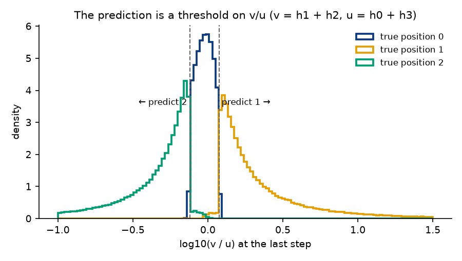

# 2nd argmax 4x3: a complete explanation

The zoo's 2nd argmax model with 4 hidden neurons and 3 inputs (32 parameters,
98.45% accurate). Every number here comes from
`python scripts/explain_small.py --hidden 4 --seq-len 3`
(`explain/summary.json`, 2^20 float64 `randn` inputs unless stated), whose
exact accuracy uses the cone enumeration in `algzoo_interp/cones.py`, or from
`python scripts/exact_accuracy.py` (`../compare/exact_accuracy.md`).

## Summary

For 3 inputs, the 2nd largest is the **median**. The model computes it as
follows:

1. **The neurons form two sign-flipped pairs, (0, 1) and (2, 3), and at
   each step one pair is on.** Which one is a comparison of consecutive
   inputs: x0 > 0 at step 0, x1 > x0 at step 1, x2 > x1 at step 2.
2. **The final state reduces to two numbers:** u = h0 + h3 and v = h1 + h2.
   In the common cases they are (close to) absolute values of two
   combinations of the consecutive differences d = x2 − x1 and e = x1 − x0:
   u ≈ |4d − e| and v ≈ |4.7d + e|.
3. **The readout thresholds the ratio v/u:** position 1 if v/u > 1.19,
   position 2 if v/u < 0.76, otherwise position 0.

Errors (1.55%) come from two sources: the neurons within a pair switch at
slightly different points, which creates "mixed" states, and the |·|-and-ratio
design itself fails when one consecutive difference is much larger than the
other.

## 1. Sign symmetry

Swapping neurons 0 ↔ 3 and 1 ↔ 2 flips the sign of the input weights and leaves
the recurrent and readout weights unchanged, to within 0.017 (input), 0.019
(recurrent, against weights up to 2.8) and 0.046 (readout, against weights up
to 18.7). So negating the input permutes the hidden state and leaves the
logits unchanged: f(−x) = f(x).

- The prediction is the same for x and −x on 99.57% of inputs.
- The activation pattern maps onto itself under the swap for 99.47%.

This matches the task. Negating all inputs turns the median into the median,
so the answer is unchanged.

## 2. Each step makes one comparison

At each step either neurons (0, 1) are on (`+`) or (2, 3) are (`-`). Which pair
is on tracks one comparison:

| step | comparison | agreement with "neuron 0 on" | exactly one full pair on |
|---|---|---|---|
| 0 | x0 > 0 | 100% | 100% |
| 1 | x1 > x0 | 96.4% | 92.5% |
| 2 | x2 > x1 | 93.8% | 83.1% |

The agreement isn't perfect because the four neurons switch at slightly
different points. At step 1, for x0 > 0, the on-thresholds are x1 > 1.27 x0
(neuron 0), x1 > 0.81 x0 (neuron 1), x1 < 0.79 x0 (neuron 2) and x1 < 1.24 x0
(neuron 3). Between them one neuron from each pair is on: a **mixed** state.

## 3. The readout uses only the ratio v/u

The readout's columns for neurons 0 and 3 are equal, as are those for 1 and 2,
so the logits depend only on u = h0 + h3 and v = h1 + h2:

| logit | weight on u | weight on v |
|---|---|---|
| 0 | −1.66 | 1.61 |
| 1 | −18.74 | 15.98 |
| 2 | 11.45 | −15.72 |

Comparing logits, the prediction depends only on the ratio v/u: **1 if
v/u > 1.188, 2 if v/u < 0.757, else 0**. Logit 0 has small weights, so it is the
default when the large logits 1 and 2 cancel. This rule agrees with the model
on **99.78%** of inputs (`explain/ratio.png`). The three true classes occupy
separate bands of log10(v/u): position 2 below −0.07, position 0 between −0.12
and 0.07, position 1 above 0.04 (1st-99th percentiles).

In the main cones, u and v are exact linear maps of x. The two most common
cones, each 18.8% of inputs:

| cone | u | v |
|---|---|---|
| `+ - +` | 0.49 x0 − 4.92 x1 + 3.97 x2 | −1.35 x0 − 3.70 x1 + 4.70 x2 |
| `- + -` | −0.46 x0 + 4.91 x1 − 3.97 x2 | 1.37 x0 + 3.72 x1 − 4.72 x2 |

Dropping the small x0 terms, these are u ≈ ±(4d − e) and v ≈ ±(4.7d + e),
with d = x2 − x1 and e = x1 − x0. Plugging in shows how thresholds on v/u
compute the median. For example, when x1 is the smallest (e = −f, f > 0), the
boundary between "position 0" and "position 2" falls at f ≈ 0.95 d, where the
true boundary (x0 = x2) is f = d.

## 4. Exact accuracy, without sampling

With 3 inputs every activation-pattern cone is a convex polygon on the unit
sphere, and its probability under N(0, I) is its area / 4π.
`algzoo_interp/cones.py` enumerates all **70** cones exactly by splitting the
sphere along each neuron's on/off plane step by step, then splits each cone
by predicted and true class.

- **Exact accuracy: 0.98455.** Sampled (2^20 inputs): 0.98443 ± 0.00012.
- Cone probabilities sum to 1, and so do the per-cone class splits (tested).
- The same method matches sampling within one standard error for the 3x3,
  5x3 and 8x3 models too (`../compare/exact_accuracy.md`).

The full table is in `explain/cones.md`. Where the error comes from:

| cones | probability | error | share of error |
|---|---|---|---|
| clean: one full pair on at every step | 0.759 | 0.0019 | 13% |
| mixed or all-off at some step | 0.241 | 0.0135 | 87% |

The two mirror-image mixed cones `+ - m1010` and `- + m0101` (3.3% of inputs
each, 89% accurate) alone account for 48% of the error. They almost always
wrongly predict position 0. In mixed states u and v come from different pairs,
so their ratio drifts toward 1, the default. When every neuron is off at the
last step (0.17% of inputs), all logits are 0 and `argmax` returns position 0.

## 5. Rebuilds from the explanation

| rebuild | agrees with model | accuracy |
|---|---|---|
| ratio rule on the model's own u, v | 99.78% | 98.39% |
| u = \|4d − e\|, v = \|4.7d + e\|, model thresholds | 97.18% | 96.56% |
| ideal: u = \|4.08d − e\|, v = \|4.84d + e\| (thresholds exactly on the median boundaries) | 98.84% | 98.60% |
| clean state: the model's own maps with pairs forced to switch together | 98.11% | 99.15% |

- The **readout** explanation passes (99.78%).
- The **two-number formula** captures the mechanism (98.8% agreement) but is
  just short of the 99% target. Even with ideal coefficients it is only
  98.6% accurate. The |·|-and-ratio design fails when one consecutive
  difference dominates: if x2 is barely above x1 after a large jump from x0,
  u and v are both large and nearly equal, the ratio goes to about 1, and the
  answer defaults to position 0.
- **Removing mixed states** (clean state) makes the model *more* accurate
  (99.15%). So about half the model's 1.55% error comes from the pairs
  switching at slightly different points, and about half is built into the
  design.

## 6. Resample check

If the readout only uses v/u, then swapping final hidden states between
inputs with (almost) the same v/u shouldn't change predictions. Sorting inputs
by log(v/u) into 2,000 equal-count bins and permuting final states within each
bin leaves the prediction unchanged for **99.76%** of inputs (excluding the
4.7% with u = 0).

## The four explanation checks

| check | result |
|---|---|
| Rebuild by hand (≥ 99% agreement) | **Partial.** The ratio readout: 99.78%. The full two-number formula: 98.84%. |
| Resample check | **Pass.** 99.76%. |
| Estimate accuracy without sampling | **Pass.** Exact 0.98455 vs sampled 0.98443 ± 0.00012, with the error attributed to cone types. |
| Write-up | This file. |
